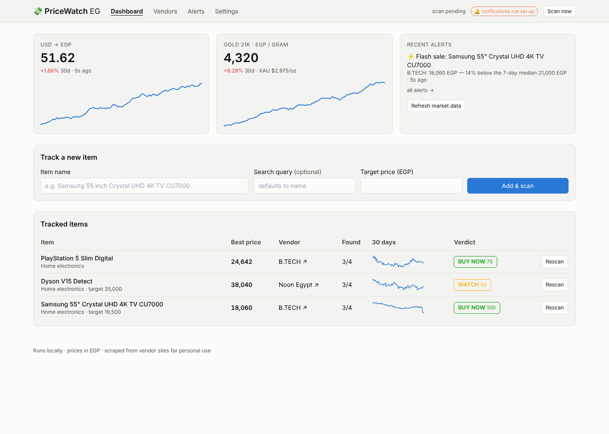

# PriceWatch EG 💸

A small app that runs on your laptop and watches the prices of items you care about
(home electronics mainly, but anything works) across the trusted Egyptian online stores.
Every 2 minutes it re-checks each vendor, keeps the full price history, detects flash
sales, and pushes a free notification to your iPhone and your friend's Android.
The dashboard answers **"should I buy now?"** and shows the USD→EGP and gold (21K/gram)
curves, because those two drive electronics prices in Egypt.

Scraping only — no paid APIs, no cloud, no accounts.



## What you get
- **16 trusted vendors pre-loaded**: Amazon Egypt, Noon, Jumia, B.TECH, 2B, Raya Shop,
  Carrefour Egypt, Tradeline, Dubai Phone, El Araby Group, Homzmart, Sharaf DG Egypt, Shaheen,
  El Ksass, EHAB Center, Cairo Sales (plus eXtra and Sigma, disabled).
  Add, edit, disable or remove vendors from the Vendors page.
- **Per vendor link or "not found"** for every item, with a one-click Pin to paste the exact
  product URL when auto-discovery misses it.
- **Alerts you can switch on/off per scenario** (Settings): flash sale (drop ≥10% vs the 7-day
  median), target price hit, new all-time low, back in stock (optionally only at a good price),
  out of stock at a vendor, unavailable everywhere. Plus a global "pause all notifications".
- **Availability tracking**: each vendor shows available / out of stock / not found, and the
  best price only counts vendors that actually have it.
- **Interested toggle** per item: one click pauses scanning and alerts for that item without
  deleting its history.
- **Buy-now verdict** (0–100 score with reasons) using 30-day range, trend, vendor spread,
  USD/EGP momentum and gold momentum.
- **Free phone push** via [ntfy](https://ntfy.sh) (iOS + Android) with any number of subscriber
  topics. Telegram optional.
- **Phone-friendly UI** and a simple login so you can expose it through ngrok.

## Install on Windows (recommended: native, no Docker)
Requires Python 3.11+ from python.org (tick "Add to PATH"). In PowerShell:

```powershell
git clone <this repo> pricewatch-eg; cd pricewatch-eg
```
```powershell
py -m venv .venv; .\.venv\Scripts\Activate.ps1
```
```powershell
pip install -e ".[dev]"; playwright install chromium
```
```powershell
copy .env.example .env; notepad .env
```
Set at least `PW_AUTH_PASSWORD` and your `PW_NTFY_TOPICS`, then start it with `pricewatch`
(or double-click `scripts\run.bat`). To start it automatically: Task Scheduler → Create Basic Task
→ trigger "When I log on" → action "Start a program" → `C:\path\to\pricewatch-eg\scripts\run.bat`.

Why native rather than Docker on Windows: no Docker Desktop / WSL2 layer to keep running, Chromium
can open a visible window when a store shows a captcha once (`PW_PLAYWRIGHT_HEADLESS=false`), and
the scans use your home IP either way. Docker is still supported if you prefer it:

```powershell
docker compose up -d --build
```
The database and browser profile live in the `pricewatch-data` volume. Note that a headful
browser for solving captchas is not available inside the container.

## Install on macOS / Linux
Requires Python 3.11+.

```bash
git clone <this repo> pricewatch-eg && cd pricewatch-eg
python -m venv .venv
```
Activate the venv (`.venv\Scripts\activate` on Windows, `source .venv/bin/activate` elsewhere), then:
```bash
pip install -e ".[dev]"
```
```bash
playwright install chromium
```
```bash
cp .env.example .env
```

## Run
```bash
pricewatch
```
Open http://127.0.0.1:8765. The first scan and the market-data fetch run at startup,
then every 2 minutes / 15 minutes. `scripts/run.sh` and `scripts/run.bat` do the same
with the venv activated — good targets for "run at login" (Task Scheduler on Windows,
a LaunchAgent on macOS, or a systemd user service on Linux).

Other commands:
```bash
pricewatch scan          # one scan cycle, prints a summary
```
```bash
pricewatch market        # fetch USD/EGP + gold once
```
```bash
pricewatch add "Samsung 55 inch CU7000" --target 20000   # track an item from the terminal
```
```bash
pricewatch test-notify   # send a test push
```

A first item (the LG GN-H722HLHL refrigerator) is pre-loaded on a fresh database so the
dashboard is not empty on day one.

## Phone notifications (free, both platforms, any number of people)
1. Install **ntfy** on each phone (App Store / Play Store / F-Droid).
2. Pick long random topic names, e.g. `pricewatch-ahmed-7f3k9q2x`. Anyone who knows a topic can
   read its alerts, so don't make them guessable.
3. In PriceWatch → Settings → *ntfy topics*, add one line per subscriber (or one shared line for
   everyone) → Save → *Send test notification*.
4. On each phone: *Subscribe to topic* → enter that person's topic.

## Opening it from your phone / through ngrok
1. In `.env` set `PW_AUTH_USER` and a strong `PW_AUTH_PASSWORD`, then restart. Every page then asks
   for a login (HTTP Basic Auth, works in any phone browser). The dashboard shows a red warning
   until this is set.
2. Run `ngrok http 8765` and open the https URL ngrok prints. For a second lock, ngrok can also
   enforce its own login: `ngrok http 8765 --basic-auth="admin:yourpassword"`.
3. On the same Wi-Fi without ngrok, set `PW_HOST=0.0.0.0` and open `http://<laptop-ip>:8765`.

## How "not found" and pinning work
For each item × vendor the scanner runs the vendor's search page, extracts product cards
(Shopify JSON → JSON-LD → CSS selectors → heuristic fallback), and picks the best title
match above the threshold. No match → **not found**. If you know the vendor sells it,
open the item page and **Pin** the product URL; pinned pages are read directly every cycle,
which is also the most reliable mode.

## When a vendor stops working
Storefronts redesign often and some use bot protection. On the Vendors page open the
vendor, press **Test search**, and look at what was extracted. Adjust the CSS selectors
(the field hints explain each one) and save. If a vendor shows a captcha, set
`PW_PLAYWRIGHT_HEADLESS=false` in `.env`, restart, solve it once in the window that opens;
the browser profile in `.playwright-profile/` remembers the clearance.

## Development
See `CLAUDE.md` for the project conventions and `docs/PLAN.md` for scope and status.
```bash
pytest -q && ruff check .
```
